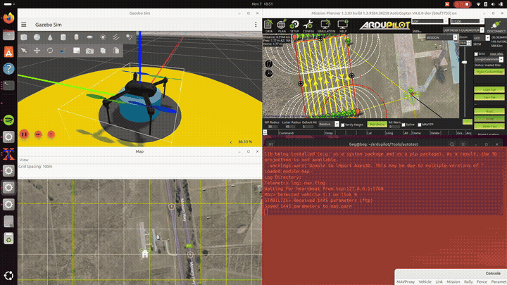
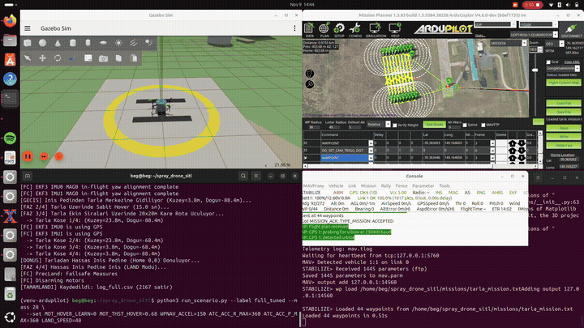
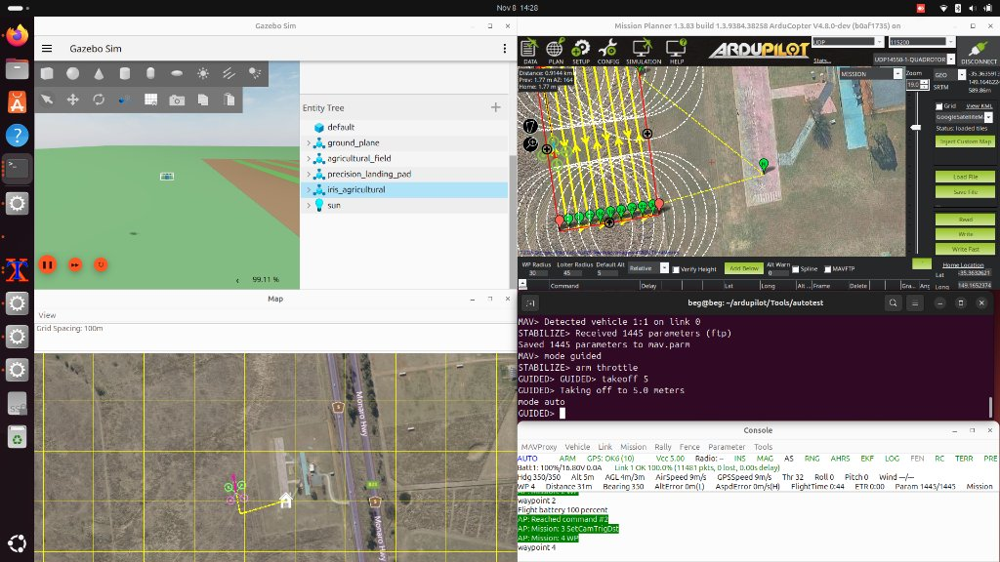
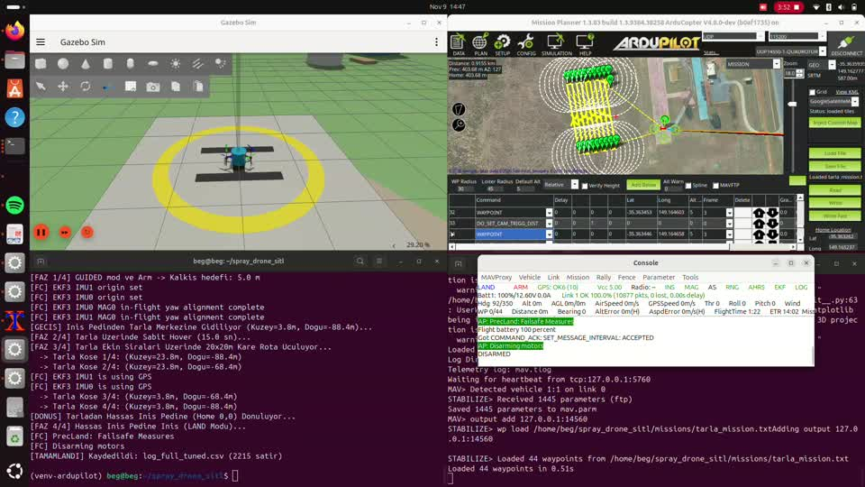
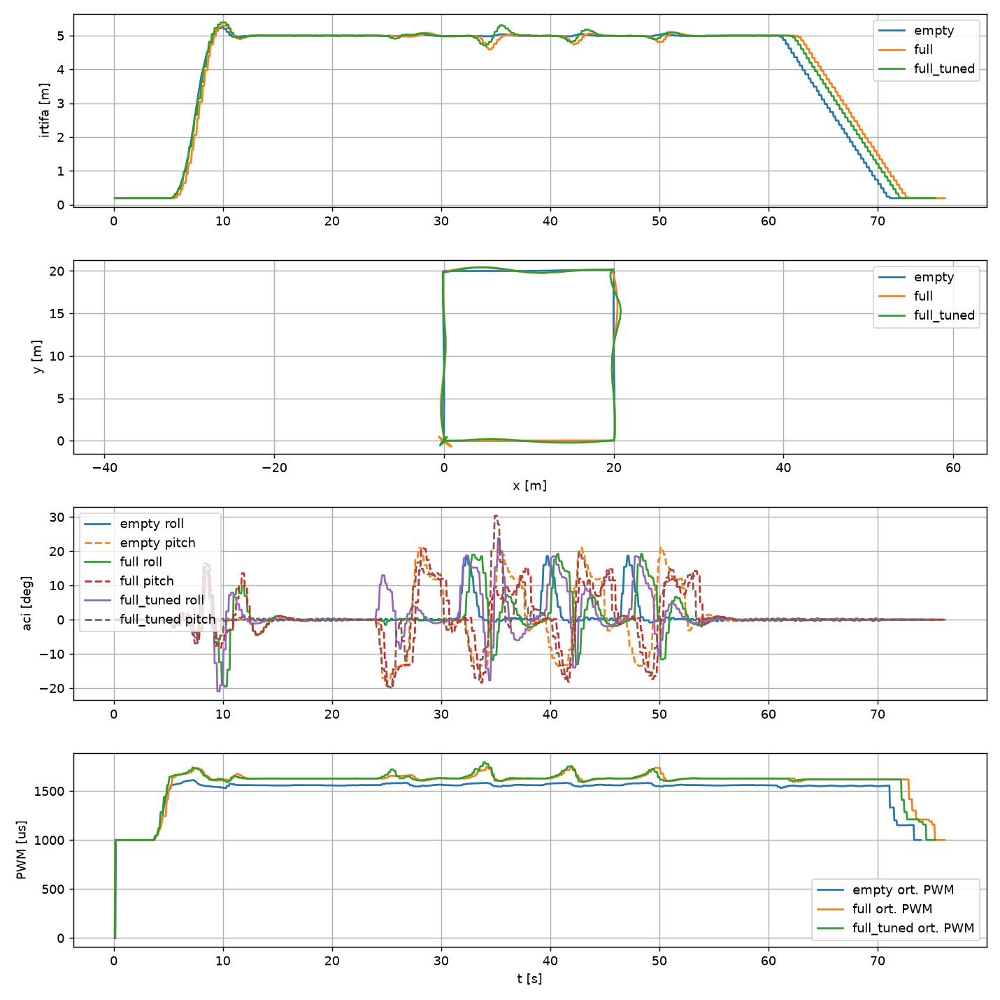

# 16 L Tarımsal İlaçlama Dronu – ArduPilot SITL & Gazebo Kontrol Çalışması

[](https://ubuntu.com/)
[](https://ardupilot.org/)
[](https://gazebosim.org/)
[](https://www.python.org/)
[](https://ardupilot.org/planner/)

**ArduPilot Copter SITL, Gazebo Sim ve Mission Planner kullanılarak 16 L tank kapasiteli tarımsal ilaçlama dronunda boş/dolu tank kütle ve ağırlık merkezi (CG) değişimlerinin kalkış, askı (hover), rota izleme ve iniş kontrolüne etkisinin incelenmesi ve iyileştirilmesi.**

> **Not**: Bu depodaki tüm araç kütleleri, atalet momentleri, itki ölçeklemeleri ve tank/bom geometrileri gerçek ürün verisi değil, simülasyon analizi için açıkça etiketlenmiş **varsayımlardır**.

---

## Sistem Çalışırken (Gazebo Sim + Mission Planner + MAVLink)

<div align="center">
  <table>
    <tr>
      <td width="50%">
        
        <br/>
        <em>Hassas iniş pedi üzerindeki 16 L ilaçlama dronu ve Mission Planner 43 waypoint'li tarla tarama görevi</em>
      </td>
      <td width="50%">
        
        <br/>
        <em>MAVLink senaryo koşucusu (empty / full / full_tuned) ve sarı hassas iniş pedine otonom iniş</em>
      </td>
    </tr>
    <tr>
      <td width="50%">
        
        <br/>
        <em>Pist kaldırılarak görev koordinatlarıyla hizalanmış 65×95 m Gazebo tarlası ve Mission Planner rotası</em>
      </td>
      <td width="50%">
        
        <br/>
        <em>16 L silindirik mavi tank, 80 cm ilaçlama bomu, 4 kırmızı nozul ve sarı/siyah hassas iniş pedi</em>
      </td>
    </tr>
  </table>
</div>

## Telemetri Karşılaştırması (Boş Tank vs. Ayarsız Dolu Tank vs. Ayarlı Dolu Tank)

<div align="center">
  
  <br/>
  <em>Üç senaryo için irtifa takibi, 20×20 m yatay kare rota izleme, Roll/Pitch açısal yanıtları ve ortalama motor PWM sinyalleri</em>
</div>

---

## Proje Özeti

Tarımsal ilaçlama dronları, tek bir görev içerisinde toplam kalkış kütlesinin yarıdan fazlasını (16 L sıvı ≈ 16 kg) kaybeder. Bu çalışma, **12 kg boş gövde** ile **28 kg tam dolu tank** durumları arasındaki kütle, atalet momenti ve ağırlık merkezi (CG) değişimlerinin ArduPilot Copter kontrol döngülerine etkisini **Gazebo 3B fizik simülasyonu** ve **gerçek MAVLink telemetrisi** ile inceler:

- **Özel 3B Tarımsal Gazebo Ortamı**: Standart `iris_runway` dünyasındaki asfalt pist kaldırılmış; yerine Mission Planner'daki 43 waypoint'lik tarama (Survey Grid) koordinatlarıyla birebir örtüşen **65×95 m tarım arazisi (6 ekin sırası)** ve Home (`0, 0`) noktasında **hassas iniş pedi (`precision_landing_pad`)** yerleştirilmiştir.
- **16 L İlaç Tankı ve Bom Modellemesi**: `iris_agricultural` modeline silindirik sıvı tankı (`spray_tank_link`), 80 cm püskürtme bomu ve 4 adet nozul eklenmiş; dolu tank senaryosunda ek kütle, artırılmış $I_{xx}, I_{yy}, I_{zz}$ atalet momentleri ve kaçık ağırlık merkezi (**+2.5 cm X, +1.5 cm Y, −14 cm Z**) tanımlanmıştır.
- **Tekrarlanabilir Otomatik Uçuş ve Analiz Hattı**: `run_scenario.py` betiği MAVLink üzerinden ArduPilot SITL'e bağlanarak parametreleri ayarlar, tam otomatik `GUIDED kalkış (5 m) → 15 sn sabit hover → 20×20 m kare rota → LAND` görevini uçurur ve 20 Hz'de telemetri kaydeder. `analyze.py` ise bu verilerden 14 mühendislik metriğini ve 4 panelli karşılaştırma grafiğini (`comparison.png`) otomatik üretir.

---

## Sistem Mimarisi

```text
+-----------------------------------------------------------------------------------+
|                        Gazebo Sim 8.11 (worlds/farm_field.sdf)                    |
|   +-----------------------------+         +-----------------------------------+   |
|   |   iris_agricultural.sdf     |         | 65x95m Tarla (6 Ekin Sırası)      |   |
|   | - 16L Tank + Bom + Nozullar |         | + Sarı/Siyah Hassas İniş Pedi     |   |
|   | - Kütle, Atalet & CG Kayması|         +-----------------------------------+   |
|   +--------------+--------------+                                                 |
+------------------|----------------------------------------------------------------+
                   | JSON Fizik Köprüsü (UDP 9002 / 9003)
                   v
+-----------------------------------------------------------------------------------+
|                  ArduPilot Copter SITL V4.8.0-dev (JSON Физик Backend)            |
|     Kaskad Kontrol: Konum (PSC/WPNAV) -> Açı (ATC_ANG) -> Hız PID (ATC_RAT)       |
+------------------+------------------------------------+---------------------------+
                   | UDP 14550                          | UDP 14560
                   v                                    v
+----------------------------------+  +---------------------------------------------+
|     Mission Planner 1.3.83       |  |     run_scenario.py & analyze.py (Python)   |
| - 43-WP Tarla İlaçlama Görevi    |  | - Otomatik Kalkış -> Hover -> Rota -> İniş  |
| - Canlı HUD ve Parametre İzleme  |  | - CSV Loglama, Metrikler & comparison.png   |
+----------------------------------+  +---------------------------------------------+
```

---

## Karşılaştırmalı Simülasyon Sonuçları

Aşağıdaki metrikler `run_scenario.py` ile koşulan üç senaryonun (`logs/log_empty.csv`, `logs/log_full.csv`, `logs/log_full_tuned.csv`) `analyze.py` tarafından işlenmesiyle doğrudan elde edilmiştir (`metrics_summary.csv`):

| Metrik | `empty` (12 kg Boş) | `full` (28 kg Ayarsız) | `full_tuned` (28 kg Ayarlı) | Mühendislik Yorumu |
|---|---:|---:|---:|---|
| **`MOT_THST_HOVER`** | `0.39` | `0.39` | **`0.68`** | Dolu tank için gerçek askı gazı (hover throttle) ön-beslemesi |
| **`WPNAV_ACCEL` (cm/s²)** | `250` | `250` | **`150`** | Köşe dönüşlerinde motor doyumunu önlemek için yatay ivme sınırı |
| **`ATC_ACC_R/P_MAX` (cdeg/s²)** | `1100` | `1100` | **`360`** | Ağır tank ve sıvı çalkantısını yumuşatmak için açısal ivme sınırı |
| **Kalkış Aşımı (`takeoff_overshoot_m`)** | `0.022 m` | `0.006 m` | `0.004 m` | Ağır kütle dikey aşımı sönümler ancak tırmanmayı yavaşlatır |
| **Hover İrtifa Std (`hover_alt_std_m`)** | `0.004 m` | `0.025 m` | `0.027 m` | Askı fazında cm mertebesinde dikey irtifa kararlılığı |
| **Hover Roll/Pitch Std (`deg`)** | `0.22°` | `6.17°` | **`5.08°`** | Yüksek atalet sönümü düşürür; ivme ayarı salınımı **%18 azaltır** |
| **Hover XY Gezintisi (`hover_xy_std_m`)** | `0.000 m` | `0.346 m` | **`0.214 m`** | Askıda yatay konum gezintisinde **%38 iyileşme** |
| **Rota XY RMS Hatası (`route_xy_err_rms_m`)** | `9.29 m` | `9.05 m` | `9.03 m` | 20×20 m kare rota boyunca basamak referansına olan RMS mesafe |
| **Rota Maks. İrtifa Hatası (`route_alt_err_max_m`)** | `0.04 m` | `0.41 m` | **`0.31 m`** | Köşe dönüşlerindeki irtifa çökmesinde **%24 azalma** |
| **Ortalama Motor PWM (`pwm_mean_hover_route`)** | `1561.0 µs` | `1633.9 µs` | `1634.8 µs` | Dolu tankta askı ve seyir için **+73 µs** daha yüksek motor komutu |
| **Maksimum Motor PWM (`pwm_max`)** | `1665 µs` | `1950 µs` | `1950 µs` | Ağır yükle yapılan dönüşlerde motorlar üst limite yaklaşır |
| **Motor PWM Dengesizliği (`pwm_imbalance_pct`)** | `%0.52` | `%7.62` | `%7.85` | Kaçık CG (+2.5 cm X, +1.5 cm Y) motorları asimetrik yükler |
| **Doyum Süresi (`sat_pct_time_pwm>1900`)** | `%0.00` | `%2.48` | `%3.07` | Manevra sırasında `1900 µs` üzerindeki motor çalışma oranı |
| **İniş Ortalama / Maks. $V_z$ (son 2 m)** | `0.287 / 0.503 m/s` | `0.270 / 0.500 m/s` | `0.271 / 0.500 m/s` | Son 2 metrede kontrollü dikey iniş hızı |
| **Maks. Titreşim (`vibe_max_xyz`) & Clip** | `0.025 m/s²` (`0`) | `0.068 m/s²` (`0`) | `0.072 m/s²` (`0`) | SITL'de ivmeölçer doyumu (`clipping`) yok; ağır yükte gövde titreşimi 3 kat artar |

---

## Metodoloji ve Kontrol Tasarımı

### 1. Fiziksel Modelleme (`models/iris_agricultural/model.sdf`)
Gerçek bir hava aracında gövde fiziği mekanik tasarımda, kontrol parametreleri ise uçuş kontrolcüsünde yer aldığı için modelleme iki ayrı katmanda gerçekleştirilmiştir:
- **Gövde ve İlaçlama Donanımı:** Standart `iris` gövdesi altına `spray_tank_link` (16 L silindirik sıvı tankı, 80 cm püskürtme bomu ve 4 adet nozul) eklenmiş ve `spray_tank_joint` ile `base_link`'e bağlanmıştır.
- **Boş Tank (`empty` – 12 kg ölçekli karşılığı):** `spray_tank_link` kütlesi `<mass>0.001</mass>` ve ağırlık merkezi `<pose>0 0 0 0 0 0</pose>` (simetrik merkezde) tanımlanmıştır.
- **Dolu Tank (`full` ve `full_tuned` – 28 kg ölçekli karşılığı):** Ölçekli sıvı kütlesi `<mass>0.85</mass>`, artırılmış atalet tensörü (`ixx=0.012, iyy=0.012, izz=0.015`) ve kaçık ağırlık merkezi `<pose>0.025 0.015 -0.14 0 0 0</pose>` (**+2.5 cm ileri, +1.5 cm sağa, 14 cm aşağı**) olarak modellenmiştir.

### 2. Faz İzolasyonlu Senaryo ve Telemetri Hattı (`run_scenario.py` & `analyze.py`)
Mission Planner için hazırlanan 43 waypoint'li tam tarla ilaçlama görevine (`missions/tarla_mission.txt`) ek olarak, kontrol döngüsü basamak yanıtlarını (step response) faz bazında ayrıştırmak amacıyla tekrarlanabilir bir test dizisi (`GUIDED kalkış → 15 sn sabit hover → 20×20 m kare rota → LAND`) uygulanmıştır:
- **Telemetri Kaydı:** `run_scenario.py`, uçuş öncesinde MAVLink `PARAM_SET` ile senaryo parametrelerini yazar ve `MAV_CMD_SET_MESSAGE_INTERVAL` komutuyla `LOCAL_POSITION_NED` (20 Hz), `ATTITUDE` (20 Hz), `SERVO_OUTPUT_RAW` (10 Hz), `VIBRATION` (5 Hz) ve `EKF_STATUS_REPORT` (2 Hz) akışlarını talep ederek `logs/log_*.csv` dosyalarını oluşturur.
- **Metrik ve Grafik Üretimi:** `analyze.py`, kaydedilen zaman serilerini uçuş fazlarına (`takeoff`, `hover`, `route`, `land`) göre filtreleyerek kalkış aşımını, askıdaki açısal/yatay standart sapmaları, 90° köşe dönüşlerindeki maksimum irtifa çökmesini, CG kaynaklı motor PWM dengesizliğini ve son 2 metredeki iniş dikey hızını hesaplayıp `metrics_summary.csv` ve `figures/comparison.png` çıktılarını üretir.

### 3. Telemetri Bulgularına Dayalı Kontrol İyileştirmesi (`full` → `full_tuned`)
Ayarsız dolu tank (`full`) koşusunda gözlemlenen iki temel kısıt üzerinden `full_tuned` parametre seti belirlenmiştir:
- **Askı Gazı İleri-Beslemesi (`MOT_THST_HOVER: 0.39 → 0.68`):** Kütle artışıyla ortalama motor komutu `1561.0 µs`'den `1633.9 µs`'ye (+73 µs) yükselmiştir. İrtifa kontrolcüsünün (`PSC_ACCZ_I`) integratör birikimini beklememesi için gerçek askı gazı doğrudan ileri-besleme olarak tanımlanmıştır (deney sırasında A/B tutarlılığı için `MOT_HOVER_LEARN=0` ile öğrenme dondurulmuştur).
- **İvme Sınırlaması (`WPNAV_ACCEL: 250 → 150`, `ATC_ACC_R/P_MAX: 1100 → 360`, `LAND_SPEED: 50 → 40`):** `full` koşusunda 90° köşe dönüşlerinde motorların `1950 µs` doyuma ulaşması (`%2.48` süre) ve `0.41 m` irtifa çökmesi nedeniyle yatay ve açısal ivme limitleri düşürülmüştür. Bu düzenleme köşe dönüşlerindeki irtifa çökmesini **`0.31 m`'ye (%24 iyileşme)**, hover yatay gezintisini **`0.214 m`'ye (%38 iyileşme)** ve açısal salınımı **`5.08°`'ye (%18 iyileşme)** indirmiştir.

### 4. Kontrol Döngüsü Rol Ayrımı ve Yöntem Seçimi
- **Kaskad Bileşenler:** İç döngü **Rate PID (`ATC_RAT_*`, 400 Hz)** açısal hız hatasını ve kaçık CG momentini (`I` terimi) bastırır; dış döngü **Position/Altitude Loop (`PSC_*`, `WPNAV_*`)** konum hatasını hedef eğim açısına çevirir; **Feed-Forward** faz gecikmesini azaltır; **Acceleration Limit** sıvı çalkantısını ve aktüatör doyumunu önler; **Harmonik Notch Filtre (`INS_HNTCH_*`)** ise motor/pervane titreşimlerini D-terimine ulaşmadan süzgeçler.
- **Gain Scheduling vs. LQR/MPC:** İlaçlama görevinde sıvı kütlesi 16 L'den 0 L'ye monotonik olarak azaldığı için debimetre veya sıvı seviye sensörüne bağlı **Gain Scheduling (Kazanç Çizelgeleme)** ArduPilot mimarisiyle doğrudan uyumlu ve düşük risklidir. Buna karşılık **LQR ve MPC**, standart 400 Hz kaskad yapıyla doğrudan uyumlu olmayıp ölçülemeyen sıvı çalkantısı durumlarına karşı yüksek kararsızlık riski taşır.

---

## Kurulum ve Çalıştırma (3 Terminal)

### Önkoşullar
- Ubuntu 24.04 LTS, ArduPilot SITL (`ArduCopter V4.8.0-dev`), Gazebo Sim (`8.11.0`) + `ardupilot_gazebo` eklentisi
- Python 3.12 sanal ortamı:
  ```bash
  source ~/venv-ardupilot/bin/activate
  pip install -r requirements.txt
  ```

### Adım 1: Model ve Dünya Dosyalarını Gazebo'ya Kopyalayın
```bash
cp -r models/iris_agricultural ~/ardupilot_gazebo/models/
cp worlds/farm_field.sdf ~/ardupilot_gazebo/worlds/
```

### Adım 2: Simülasyonu ve Senaryo Koşucusunu Başlatın

**Terminal 1 – Gazebo Sim (3B Tarla ve 16 L İlaçlama Dronu):**
```bash
export GZ_SIM_SYSTEM_PLUGIN_PATH=$HOME/ardupilot_gazebo/build:$GZ_SIM_SYSTEM_PLUGIN_PATH
export GZ_SIM_RESOURCE_PATH=$HOME/ardupilot_gazebo/models:$HOME/ardupilot_gazebo/worlds:$GZ_SIM_RESOURCE_PATH
gz sim -v4 -r farm_field.sdf
```

**Terminal 2 – ArduPilot Copter SITL:**
```bash
source ~/venv-ardupilot/bin/activate
cd ~/ardupilot/Tools/autotest
./sim_vehicle.py -v ArduCopter -f gazebo-iris --model JSON --console --map \
  --add-param-file=$HOME/ardupilot/Tools/autotest/default_params/gazebo-iris.parm
```
*(MAVProxy konsolunda `output add 127.0.0.1:14560` komutuyla senaryo koşucu portunu açın.)*

**Terminal 3 – Otomatik Karşılaştırma Koşuları ve Analiz:**
```bash
source ~/venv-ardupilot/bin/activate
cd ~/spray_drone_sitl

# 1. Boş Tank (12 kg)
python3 run_scenario.py --label empty --mass 12 --set MOT_HOVER_LEARN=0

# 2. Dolu Tank - Ayarsız (28 kg)
python3 run_scenario.py --label full --mass 28 --set MOT_HOVER_LEARN=0

# 3. Dolu Tank - Ayarlı (28 kg)
python3 run_scenario.py --label full_tuned --mass 28 \
  --set MOT_HOVER_LEARN=0 MOT_THST_HOVER=0.68 WPNAV_ACCEL=150 ATC_ACC_R_MAX=360 ATC_ACC_P_MAX=360 LAND_SPEED=40

# Metrik özet tablosu ve karşılaştırma grafiğini üret
mv log_*.csv log_*_meta.json log_*_events.txt logs/
python3 analyze.py logs/log_empty.csv logs/log_full.csv logs/log_full_tuned.csv
mv comparison.png figures/
```

---

## Proje Dizin Yapısı

```text
spray_drone_sitl/
├── README.md                          # Proje dokümantasyonu, mimari, metrikler ve Soru-Cevap
├── report_draft.md                    # Teknik raporun Markdown kaynağı
├── report/
│   └── DRONEQUBE_Teknik_Rapor_Begum_Aydogan_Cicin.pdf  # 5 sayfalık teslim raporu (PDF)
├── run_scenario.py                    # Otomatik MAVLink uçuş senaryosu ve telemetri kaydedici
├── analyze.py                         # İstatistiksel metrik ve karşılaştırma grafiği üretici
├── metrics_summary.csv                # Üç senaryonun hesaplanmış karşılaştırma metrikleri
├── requirements.txt                   # Python bağımlılıkları
├── versions.txt                       # Kullanılan yazılım, donanım ve simülatör sürümleri
├── figures/
│   ├── demo_field_mission.gif         # 16 L ilaçlama dronu kalkış ve tarla görevi animasyonu
│   ├── demo_sitl_scenarios.gif        # Otomatik senaryo koşusu ve hassas iniş animasyonu
│   ├── comparison.png                 # 4 panelli zaman serisi karşılaştırma grafiği
│   ├── gazebo_farm_field.jpg          # Gazebo tarlası + Mission Planner + MAVProxy görünümü
│   └── spray_tank_landing_pad.jpg     # 16 L mavi tank, bom, nozullar ve iniş pedi yakın planı
├── logs/
│   ├── log_empty.csv                  # Koşu A (12 kg Boş Tank) 20 Hz telemetri verisi
│   ├── log_full.csv                   # Koşu B (28 kg Dolu Tank - Ayarsız) telemetri verisi
│   ├── log_full_tuned.csv             # Koşu C (28 kg Dolu Tank - Ayarlı) telemetri verisi
│   ├── *_meta.json & *_events.txt     # Her koşuda okunan parametreler ve FC durum mesajları
│   └── failed/
│       └── failed_trials_notes.txt    # Başarısız denemeler (itki doyumu, atalet taklası) ve kök nedenleri
├── missions/
│   └── tarla_mission.txt              # Mission Planner 43 waypoint'li tarla ilaçlama görevi
├── models/
│   └── iris_agricultural/             # 16 L ilaç tankı, bom ve nozul eklenmiş Gazebo SDF modeli
├── params/
│   ├── backup_original.parm           # Orijinal fabrika parametre yedeği (1445 parametre)
│   ├── before_empty.parm              # Boş tank konfigürasyonu
│   └── before_full_tuned.parm         # Ayarlı dolu tank konfigürasyonu
└── worlds/
    └── farm_field.sdf                 # 65×95 m tarla ve hassas iniş pedi içeren Gazebo dünyası
```

---

## Başarısız Denemeler ve Simülatör Sınırlamaları

1. **İtki Ölçeklemesi Olmadan 28 kg Kalkış Denemesi (`Thr 100` Doyumu):**
   - Standart Iris rotor sabitleriyle (`forceConstant = 8.54858e-06`) kütle doğrudan 28 kg yapıldığında maksimum toplam itki (~34 N) yerçekimi kuvvetini (274.6 N) yenememiş ve araç yerden kesilememiştir.
2. **Atalet Tensörü Ölçeklenmeden İtki Artırımı (`AngErr=170>30` Taklası):**
   - Sadece rotor itkisi artırılıp $I_{xx}, I_{yy}$ atalet momentleri küçük bırakıldığında ilk waypoint dönüşünde aşırı açısal ivme nedeniyle araç takla atmış ve `Crash: Disarming: AngErr=170>30` hatasıyla motorları kesmiştir.
3. **Simülatör Sınırlamaları (Gerçek Saha Farkları):**
   - Gazebo'da tank içi sıvı katı bir kütle ve sabit CG ofseti olarak modellenmiştir; gerçek uçuşta **sıvı çalkantısı (sloshing)** ~0.8–1.5 Hz arasında gecikmeli faz kayması yaratır ve tank bölmeleri (baffle) + düşük ivme limitleri (`WPNAV_ACCEL`, `ATC_ACC_*`) gerektirir.
   - Gazebo zemin etkileşimi çok rotorlu **yer etkisini (ground effect)** ve ekin kanopisi türbülansını tam simüle etmez; sahada barometrik yastıklanmaya karşı aşağı bakan **1D LiDAR (`RNGFND1`)** kullanılmalıdır.
